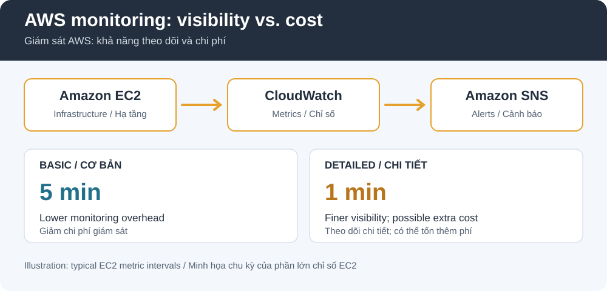

## Introduction

While learning about AWS and developing the NetMon network monitoring project, I realized that monitoring plays an important role in system operations. Amazon CloudWatch collects metrics and logs, helps track performance, and can trigger alerts through Amazon SNS.

However, does collecting more monitoring data always make a system better?

*Figure 1. Balancing monitoring frequency, visibility and cost (conceptual illustration).*

## Two perspectives

- **More monitoring:** Frequent measurements help detect issues earlier, support troubleshooting and reduce the risk of downtime.
- **Selective monitoring:** Collecting too much data may increase costs, generate unnecessary alerts and make analysis more difficult.

For example, Amazon EC2 basic monitoring publishes most metrics every five minutes, while detailed monitoring provides one-minute metrics and may incur additional charges. In May 2025, AWS also introduced volume-based tiered pricing for Lambda logs and additional delivery destinations, including Amazon S3 and Amazon Data Firehose.

## My perspective

For a small or medium-sized business, I believe monitoring should match the importance of each resource. In the NetMon project, a reasonable approach is to monitor critical devices more frequently, use suitable alarm thresholds and limit unnecessary log retention.

A good system is not necessarily the one that collects the most data, but the one that uses data effectively.

**What do you think? Should businesses prioritize faster incident detection or lower operating costs?** I would love to hear different perspectives from the AWS community.
## Linkmyblogs

https://www.facebook.com/share/p/19kxKGVGNd/?mibextid=wwXIfr

## References

- [AWS — Manage detailed monitoring for your EC2 instances](https://docs.aws.amazon.com/AWSEC2/latest/UserGuide/manage-detailed-monitoring.html)
- [AWS Compute Blog — Tiered pricing for Lambda logs and additional logging destinations](https://aws.amazon.com/blogs/compute/aws-lambda-introduces-tiered-pricing-for-amazon-cloudwatch-logs-and-additional-logging-destinations/)
- [Amazon CloudWatch Pricing](https://aws.amazon.com/cloudwatch/pricing/)
