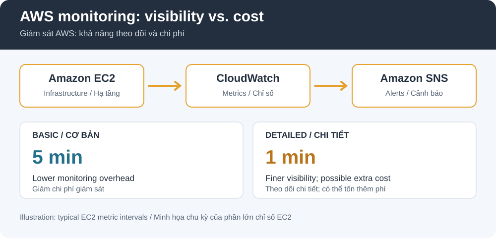

## Giới thiệu

Trong quá trình tìm hiểu AWS và xây dựng đề tài giám sát hạ tầng mạng NetMon, mình nhận thấy việc giám sát đóng vai trò quan trọng trong vận hành hệ thống. Amazon CloudWatch giúp thu thập các chỉ số và nhật ký, theo dõi hiệu suất và có thể kích hoạt cảnh báo thông qua Amazon SNS.

Tuy nhiên, liệu việc thu thập càng nhiều dữ liệu giám sát có thực sự giúp hệ thống tốt hơn?

*Hình 1. Cân bằng giữa tần suất giám sát, khả năng theo dõi và chi phí (hình minh họa nguyên lý).*

## Hai góc nhìn

- **Giám sát nhiều hơn:** Đo lường thường xuyên giúp phát hiện sự cố sớm, hỗ trợ tìm nguyên nhân lỗi và giảm nguy cơ gián đoạn hệ thống.
- **Giám sát có chọn lọc:** Thu thập quá nhiều dữ liệu có thể làm tăng chi phí, tạo ra cảnh báo không cần thiết và gây khó khăn khi phân tích.

Ví dụ, chế độ giám sát cơ bản của Amazon EC2 cung cấp phần lớn chỉ số sau mỗi 5 phút, còn chế độ giám sát chi tiết cung cấp chỉ số mỗi phút và có thể phát sinh thêm chi phí. Vào tháng 5/2025, AWS cũng giới thiệu cơ chế định giá theo bậc dựa trên dung lượng nhật ký Lambda và bổ sung đích lưu chuyển nhật ký như Amazon S3 và Amazon Data Firehose.

## Góc nhìn cá nhân

Đối với doanh nghiệp vừa và nhỏ, theo mình, việc giám sát nên phù hợp với mức độ quan trọng của từng tài nguyên. Trong dự án NetMon, một hướng hợp lý là giám sát thiết bị quan trọng thường xuyên hơn, đặt ngưỡng cảnh báo phù hợp và hạn chế lưu trữ nhật ký không cần thiết.

Một hệ thống tốt không nhất thiết là hệ thống thu thập nhiều dữ liệu nhất, mà là hệ thống sử dụng dữ liệu hiệu quả.

**Theo mọi người, doanh nghiệp nên ưu tiên phát hiện sự cố nhanh hơn hay tiết kiệm chi phí vận hành?** Mình rất mong nhận được những góc nhìn khác nhau từ cộng đồng AWS.
## Blog của tôi
https://www.facebook.com/share/p/19kxKGVGNd/?mibextid=wwXIfr
## Tài liệu tham khảo

- [AWS — Quản lý giám sát chi tiết cho các phiên bản EC2](https://docs.aws.amazon.com/AWSEC2/latest/UserGuide/manage-detailed-monitoring.html)
- [AWS Compute Blog — Định giá theo bậc cho nhật ký Lambda và các đích lưu chuyển bổ sung](https://aws.amazon.com/blogs/compute/aws-lambda-introduces-tiered-pricing-for-amazon-cloudwatch-logs-and-additional-logging-destinations/)
- [Bảng giá Amazon CloudWatch](https://aws.amazon.com/cloudwatch/pricing/)
