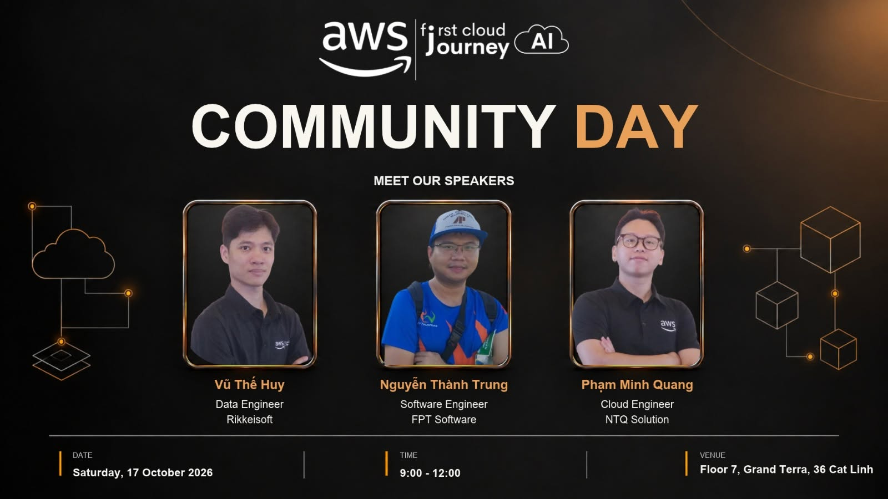

# 4.1. FCAJ WEEKLY MEETUP – HANOI

## 1. Event information

- **Event:** First Cloud AI Journey (FCAJ) Weekly Meetup
- **Date:** Saturday, October 17, 2026
- **Venue:** AWS Office, Hanoi
- **Format:** Technical talks and community meetup
- **Community:** First Cloud AI Journey / AWS Study Group

## 2. Overview

I attended the FCAJ Weekly Meetup on October 17, 2026. The event covered AI application security, AWS account governance, modern data architecture and network security. These topics were particularly relevant to my internship project on an AWS-based network infrastructure management and monitoring system.

## 3. Technical sessions

### 3.1. Securing Chatbots When Calling LLM APIs

**Speaker:** Nguyễn Thành Trung, Software Engineer at FPT Software.

The talk addressed sensitive-data protection, prompt injection risks and the secure integration of AI Agents with LLM APIs. It emphasized that AI-enabled applications still require strong authentication, authorization and input handling.

### 3.2. Migration Journey: From Disconnected AWS Accounts to a Landing Zone

**Speaker:** Phạm Minh Quang, Cloud Engineer at NTQ Solution.

This session described the transition from disconnected AWS accounts to a governed multi-account environment, including the roles of AWS Landing Zone and AWS Control Tower.

### 3.3. Beyond Parquet: Apache Iceberg on AWS

**Speaker:** Vũ Thế Huy, Data Engineer at Rikkeisoft.

Apache Iceberg was introduced as a foundation for modern data lakes, with snapshot management, time travel, schema evolution and integration with AWS data services.

### 3.4. Network Security on AWS

The final technical topic focused on defense-in-depth, network segmentation and security controls for enterprise cloud workloads. The public recap does not identify the fourth speaker, so no name is included here.

## 4. Lessons for my internship project

- Apply least-privilege access to API Gateway, Lambda and DynamoDB interactions.
- Use VPC subnets and Security Groups to avoid unnecessary exposure.
- Treat monitoring and security as connected concerns: CloudWatch alerts and operational logs should complement access control.
- Consider governance and data organization if the project expands to more AWS resources.

The meetup highlighted that reliable cloud operations depend on both observability and effective security controls.

## 5. Event photos

**Photo 1:** Overall view of the FCAJ Weekly Meetup on October 17 *(insert a verified personal or licensed organizer photo)*.

**Photo 2:** A technical session from the same event *(insert only after verifying the date)*.

<!-- Uncomment after you save the matching image in static/images/4-EventParticipated/:
[FCAJ Weekly Meetup on October 17](/images/4-EventParticipated/fcaj-2026-10-17.jpg)
-->

## 6. References

- [FCAJ recap and community updates](https://vn.linkedin.com/in/phongpham95)
- [Reposted October 17 event recap](https://vn.linkedin.com/in/trannhatminh05022004)
