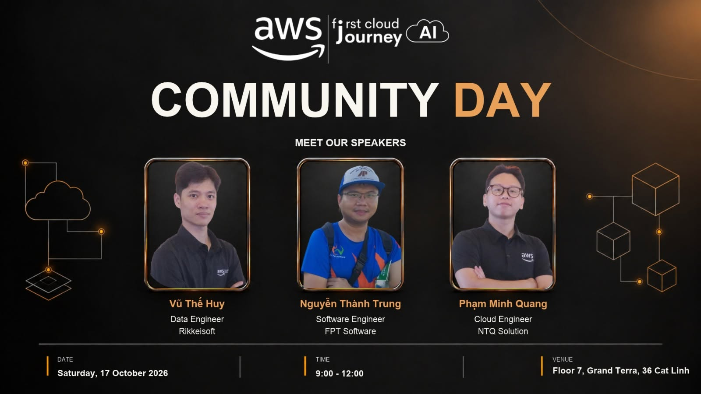

# 4.1. FCAJ WEEKLY MEETUP – HÀ NỘI

## 1. Thông tin chương trình

- **Tên:** First Cloud AI Journey (FCAJ) Weekly Meetup
- **Ngày:** Thứ Bảy, 17/10/2026
- **Địa điểm:** Văn phòng AWS tại Hà Nội
- **Hình thức:** Gặp gỡ cộng đồng và nghe các bài chia sẻ kỹ thuật
- **Đơn vị cộng đồng:** First Cloud AI Journey, AWS Study Group

## 2. Giới thiệu

Ngày 17/10/2026, tôi đã tham dự buổi Weekly Meetup của cộng đồng FCAJ tại Hà Nội. Các bài nói giới thiệu những vấn đề đang được quan tâm trong xây dựng và vận hành hệ thống đám mây: bảo mật ứng dụng AI, quản trị tài khoản AWS, tổ chức dữ liệu và an toàn mạng.

Đối với một sinh viên đang triển khai dự án giám sát hạ tầng mạng trên AWS, đây là cơ hội để đối chiếu kiến thức thực hành với những tình huống và hướng tiếp cận mà các kỹ sư chia sẻ.

## 3. Nội dung chính

### 3.1. Securing Chatbots When Calling LLM APIs

**Diễn giả:** Nguyễn Thành Trung – Software Engineer, FPT Software.

Bài chia sẻ xoay quanh các rủi ro khi chatbot hoặc AI Agent gọi API của mô hình ngôn ngữ lớn, gồm bảo vệ dữ liệu nhạy cảm, prompt injection và cách thiết kế tích hợp an toàn. Điểm đáng chú ý là ứng dụng không nên coi kết quả từ AI như dữ liệu luôn đáng tin cậy; các lời gọi API vẫn cần được xác thực, phân quyền và kiểm soát.

### 3.2. Migration Journey: From Disconnected AWS Accounts to a Landing Zone

**Diễn giả:** Phạm Minh Quang – Cloud Engineer, NTQ Solution.

Chủ đề giải thích cách chuyển từ những tài khoản AWS rời rạc sang môi trường nhiều tài khoản có nguyên tắc quản trị rõ ràng. AWS Landing Zone và AWS Control Tower được đề cập như cách tổ chức tài khoản, chính sách và vận hành thống nhất khi hệ thống mở rộng.

### 3.3. Beyond Parquet: Apache Iceberg on AWS

**Diễn giả:** Vũ Thế Huy – Data Engineer, Rikkeisoft.

Bài trình bày giới thiệu Apache Iceberg cho hệ thống dữ liệu hiện đại, nhấn mạnh khả năng quản lý snapshot, xem lại dữ liệu ở thời điểm trước (time travel), thay đổi schema và phối hợp với những dịch vụ dữ liệu trên AWS.

### 3.4. Network Security on AWS

Phiên chia sẻ tập trung vào tư duy bảo mật nhiều lớp (defense in depth), phân đoạn mạng và lựa chọn biện pháp kiểm soát phù hợp với tài nguyên đám mây. Bản tổng kết công khai xác nhận chủ đề này nhưng không nêu rõ tên diễn giả, vì vậy tôi không ghi tên để tránh sai thông tin.

## 4. Kiến thức rút ra và liên hệ đồ án

- **Phân quyền:** Khi bảo vệ API Gateway và AWS Lambda, cần xác định rõ ai được đọc hoặc chỉnh sửa dữ liệu thay vì chỉ dựa vào giao diện đăng nhập.
- **An toàn mạng:** VPC, subnet và Security Group cần thiết kế theo yêu cầu truy cập thực tế; không mở các cổng không cần thiết.
- **Giám sát:** CloudWatch Alarm, SNS và nhật ký xử lý cảnh báo giúp theo dõi sự cố, nhưng hệ thống cũng cần cấu hình quyền và lưu dữ liệu hợp lý.
- **Mở rộng:** Cách tổ chức tài khoản và dữ liệu sẽ quan trọng hơn nếu đồ án phát triển từ mô phỏng một máy EC2 thành quản lý nhiều tài nguyên.

Từ buổi tham dự này, tôi hiểu rõ hơn rằng giám sát hệ thống và bảo mật không phải hai phần tách biệt: muốn hệ thống vận hành tốt thì phải vừa thu thập được số liệu, vừa kiểm soát người dùng và các đường truy cập.

## 5. Hình ảnh minh chứng

**Ảnh 1:** Toàn cảnh buổi FCAJ Weekly Meetup ngày 17/10/2026 *(thêm ảnh cá nhân hoặc ảnh ban tổ chức được phép sử dụng)*.

**Ảnh 2:** Một phiên trình bày kỹ thuật tại sự kiện *(thêm sau khi xác nhận đúng ảnh)*.

<!-- Khi đã lưu đúng ảnh tại static/images/4-EventParticipated/, bỏ dấu comment ở một dòng phù hợp:

-->

## 6. Nguồn tham khảo

- [Bài tổng kết FCAJ Weekly Meetup 17/10/2026 – cộng đồng FCAJ](https://vn.linkedin.com/in/phongpham95)
- [Bài chia sẻ lại nội dung sự kiện](https://vn.linkedin.com/in/trannhatminh05022004)

*Ghi chú: Bản này tổng hợp nội dung chương trình theo nguồn công khai. Chỉ bổ sung các hoạt động cá nhân như chụp ảnh cùng diễn giả, đặt câu hỏi, nhận quà... nếu thực sự đã diễn ra.*
