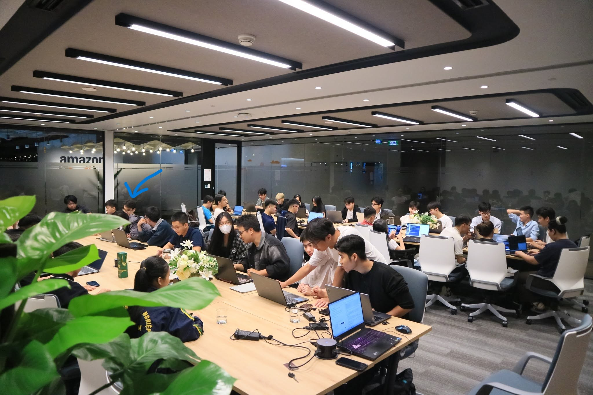

# 4.2. CLOUD & AI INFRASTRUCTURE MEETUP

## 1. Event information

- **Official title:** VOI & CNVN × AWS FCAJ (First Cloud AI Journey) Meetup: Cloud & AI Infrastructure
- **Date:** Saturday, October 24, 2026
- **Time:** 9:00-12:00 AM per the organizer announcement 
- **Venue:** Level 7, Grand Terra, 36 Cat Linh Street, Hanoi (AWS Hanoi Office)
- **Co-organizers:** VietOpenInfra, Cloud Native Vietnam and AWS First Cloud AI Journey

## 2. Overview

I attended the Cloud & AI Infrastructure Meetup on October 24, 2026, during my internship in Hanoi. The event brought together cloud engineers and AI practitioners to discuss data storage at scale, GPU infrastructure for LLMs, and practical AI applications.

## 3. Main sessions

### 3.1. Beyond S3: Object Storage Architecture and the AI Data Landscape

**Speaker:** Hà Mạnh Đông (Dong Ha), Tech Lead at OMZ JSC.

The presentation compared Ceph, MinIO and SeaweedFS as object-storage architectures and discussed scalability, metadata management, PUT/GET latency and operational costs for large AI datasets and workloads.

### 3.2. Turning GPU-Hours into Tokens, and Tokens into a Service: Agent Router and NVIDIA Dynamo

**Speakers:** Nguyễn Thế Anh and Phùng Quang Minh, Viettel Networks.

This talk covered multi-cluster LLM serving, request routing and authentication, GPU utilization, KV-cache-aware optimization and scaling. Agent Router, NVIDIA Dynamo, vLLM and SGLang were among the technologies discussed.

### 3.3. Confessions of an AI Addict

**Speaker:** Quân Phương, Senior Solutions Architect at AWS Vietnam.

The presentation explored the progression from chatbots and retrieval-augmented generation (RAG) to Agentic AI, including long-term memory, digital twins and methods for enabling AI systems to perform practical tasks.

### 3.4. Panel discussion and Q&A

The event concluded with an open discussion about practical engineering decisions and lessons learned from infrastructure and AI deployments.

## 4. Relevance to my AWS NetMon project

Although our internship project does not include a GPU cluster, the event offered useful lessons: evaluate storage as well as compute costs; observe performance bottlenecks before attempting optimization; protect APIs and control access; and use modular system components that are easier to test, monitor and scale.

## 5. Event photos

**Photo 1:** Overall view of the meetup at Grand Terra on October 24 *(insert a verified personal or permitted organizer photo)*.

**Photo 2:** Technical presentation or Q&A from the same day *(confirm date and credit)*.

<!-- Uncomment after saving the matching photo:

-->

## 6. References

- [Official event page and speaker information](https://ocgroups.dev/cncf/group/d2e22fa/event/5z4fnze)
- [VietOpenInfra official announcement](https://vn.linkedin.com/posts/voi-vn_vietopeninfra-cloudnativevietnam-awscommunityvietnam-activity-7516060456709550080-yaxC)
- [Organizer's post-event recap](https://vn.linkedin.com/posts/voi-vn_vietopeninfra-cloudnativevietnam-awsfcaj-activity-7521419750535610369-mDaT)
