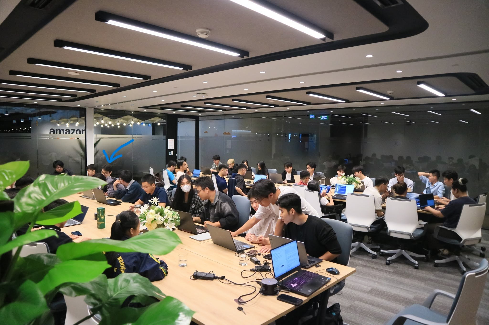

# 4.2. CLOUD & AI INFRASTRUCTURE MEETUP

## 1. Thông tin chương trình

- **Tên chính thức:** VOI & CNVN × AWS FCAJ (First Cloud AI Journey) Meetup: Cloud & AI Infrastructure
- **Ngày:** Thứ Bảy, 24/10/2026
- **Giờ theo thông báo ban tổ chức:** 9:00-12:00 
- **Địa điểm:** Tầng 7, Grand Terra, 36 Cát Linh, Hà Nội (văn phòng AWS Hà Nội)
- **Đồng tổ chức:** VietOpenInfra, Cloud Native Vietnam và AWS First Cloud AI Journey

## 2. Giới thiệu

Ngày 24/10/2026, tôi đã tham dự buổi Meetup với chủ đề **Cloud & AI Infrastructure** tại địa điểm thực tập ở 36 Cát Linh. Sự kiện mang tính chia sẻ kỹ thuật và thảo luận kinh nghiệm triển khai thực tế, tập trung vào ba nhóm vấn đề: lưu trữ dữ liệu quy mô lớn, tối ưu tài nguyên GPU phục vụ mô hình AI và xây dựng ứng dụng AI có thể khai thác dữ liệu riêng.

## 3. Nội dung chính

### 3.1. Beyond S3: Kiến trúc Object Storage và cuộc chơi dữ liệu AI

**Diễn giả:** Hà Mạnh Đông (Dong Ha) – Tech Lead, OMZ JSC.

Chủ đề phân tích vai trò của Object Storage đối với dataset, video và dữ liệu huấn luyện AI. Diễn giả so sánh các hướng thiết kế Ceph, MinIO và SeaweedFS; chỉ ra các yếu tố cần cân nhắc khi mở rộng hệ thống, như số lượng object, metadata, độ trễ thao tác PUT/GET và chi phí vận hành. Nội dung cũng đề cập hướng phát triển từ lưu trữ đối tượng sang dịch vụ hỗ trợ phân tích dữ liệu.

### 3.2. Turning GPU-Hours into Tokens, and Tokens into a Service: Agent Router and NVIDIA Dynamo

**Diễn giả:** Nguyễn Thế Anh và Phùng Quang Minh – Viettel Networks.

Phiên này giới thiệu kiến trúc phục vụ mô hình ngôn ngữ lớn (LLM) trên nhiều cụm GPU, cách định tuyến và kiểm soát request, tối ưu sử dụng bộ nhớ KV-cache và tăng khả năng mở rộng. Các khái niệm Agent Router, NVIDIA Dynamo, vLLM và SGLang được nhắc đến trong chương trình.

### 3.3. Confessions of an AI Addict

**Diễn giả:** Quân Phương – Senior Solutions Architect, AWS Việt Nam.

Bài nói chia sẻ quá trình ứng dụng AI từ chatbot, RAG (Retrieval-Augmented Generation) đến Agentic AI. Trọng tâm gồm hạn chế của mô hình khi thiếu ngữ cảnh, nhu cầu cập nhật kiến thức, quản lý bộ nhớ dài hạn và khả năng cho AI thực hiện các tác vụ thay vì chỉ trả lời câu hỏi.

### 3.4. Panel Discussion & Q&A

Chương trình có phần trao đổi, hỏi đáp về hạ tầng Cloud và AI. Theo bài tổng kết của ban tổ chức, các thảo luận đề cập đến kinh nghiệm kỹ thuật và lựa chọn giải pháp trong thực tế.

## 4. Liên hệ với đề tài AWS NetMon

Mặc dù đồ án của nhóm chủ yếu sử dụng EC2, CloudWatch, Lambda, API Gateway và DynamoDB chứ không triển khai cụm GPU, buổi Meetup vẫn mang lại những gợi ý có ích:

- **Chi phí hệ thống:** Cần đánh giá chi phí lưu trữ và thao tác đọc/ghi, không chỉ tính riêng chi phí máy chủ.
- **Giám sát và vận hành:** Với các hệ thống phức tạp, quan sát số liệu và phát hiện nút thắt là cơ sở để tối ưu hiệu năng.
- **Bảo mật API:** Những ứng dụng dùng nhiều thành phần và request cần cơ chế phân quyền, kiểm soát và ghi log đầy đủ.
- **Khả năng mở rộng:** Kiến trúc nên chia thành các thành phần độc lập để dễ kiểm thử và mở rộng trong tương lai.

Sau sự kiện, tôi nhận thấy việc chọn công nghệ không chỉ dựa vào tính năng mà còn cần cân nhắc hiệu suất, chi phí và khả năng quản trị khi vận hành thật.

## 5. Hình ảnh minh chứng

**Ảnh 1:** Toàn cảnh buổi Meetup tại tầng 7, Grand Terra ngày 24/10/2026 *(sử dụng ảnh bạn chụp hoặc ảnh ban tổ chức cho phép dùng)*.

**Ảnh 2:** Hình chụp một trong các bài trình bày hoặc phần hỏi đáp *(kiểm tra đúng ngày và ghi nguồn)*.

<!-- Khi có ảnh xác thực và đã lưu đúng đường dẫn, bỏ comment dòng sau:

-->

## 6. Tài liệu tham khảo

- [Trang chương trình, nội dung bài nói và diễn giả](https://ocgroups.dev/cncf/group/d2e22fa/event/5z4fnze)
- [Thông báo chính thức từ VietOpenInfra](https://vn.linkedin.com/posts/voi-vn_vietopeninfra-cloudnativevietnam-awscommunityvietnam-activity-7516060456709550080-yaxC)
- [Bài tổng kết của ban tổ chức](https://vn.linkedin.com/posts/voi-vn_vietopeninfra-cloudnativevietnam-awsfcaj-activity-7521419750535610369-mDaT)

*Lưu ý: Nội dung trên tổng hợp thông tin được công bố. Không mô tả các hoạt động cá nhân chưa có minh chứng, ví dụ phát biểu, nhận giải thưởng hoặc chụp ảnh cùng diễn giả.*
